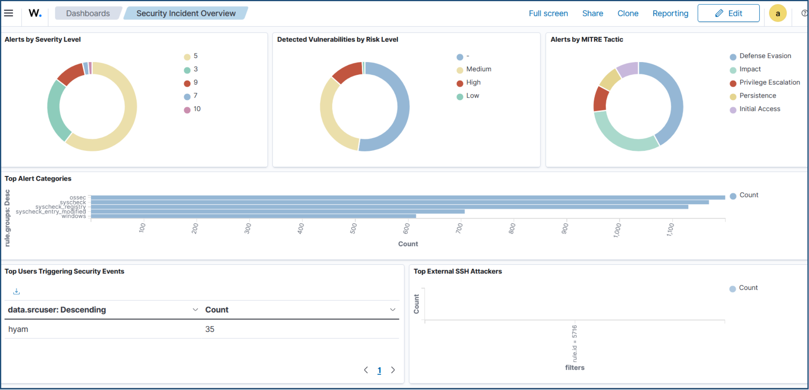

# Incident Response

## Overview

This document describes the incident response and alert analysis activities performed during the Wazuh lab.

The activities focused on simulating suspicious authentication activity, analyzing the resulting Wazuh alerts, understanding the concept of automated response, and creating a dashboard to support security incident monitoring.

---

## Incident Response Objectives

The incident response activities were designed to provide practical experience with:

- Simulating suspicious authentication activity
- Detecting security events using Wazuh
- Analyzing generated alerts
- Understanding alert severity and rule information
- Understanding the concept of automated response
- Monitoring security incidents through the Wazuh Dashboard
- Correlating repeated security alerts

---

## Brute-Force Scenario: Failed Authentication Simulation

A controlled authentication failure scenario was performed on the Debian Linux environment to simulate suspicious activity. 
The scenario was limited to repeated failed `sudo` authentication attempts on the Debian endpoint; no external SSH brute-force traffic was generated.

The test generated multiple failed `sudo` authentication attempts by the user `hyam`.

The activity was detected by Wazuh and generated an alert associated with:

```text
Rule ID: 5404
````

The alert indicated repeated failed authentication activity and provided security event information that could be reviewed through the Wazuh Dashboard.

The simulation was performed in the lab environment to validate the detection and analysis process without targeting a production system.

---

## Alert Analysis

The generated alert was analyzed using the information provided by Wazuh.

The analysis included reviewing:

* Rule ID
* Alert details
* Authentication activity
* Source information
* User involved in the activity
* Target account
* Event timing
* Alert severity

The simulated activity involved failed `sudo` authentication attempts where the user `hyam` attempted to perform an action targeting the `root` account.

This provided a practical example of how authentication-related events can be detected and investigated using Wazuh.

The alert was generated at rule level 10, which falls within the Medium range (7–11) of the Wazuh Dashboard severity classification.

---

## Active Response Concept

The lab also included studying the Wazuh Active Response capability.

Active Response is designed to allow security actions to be triggered automatically when specific security events are detected.

The `firewall-drop` response was studied as an example of a response that can be used to block suspicious IP addresses.

The activity focused on understanding how an automated response could be designed to react to suspicious activity.

The Active Response configuration was studied conceptually and was not deployed as a production or fully automated blocking implementation.

---

## Security Incident Dashboard

A custom Wazuh Dashboard named:

```text
Security Incident Overview
```

was created to support security monitoring and incident analysis.

The dashboard included visualizations related to:

* Alert severity
* Vulnerabilities
* MITRE ATT&CK tactics
* Top alert categories
* Users
* External SSH attackers

The dashboard provided a centralized view of security-related information and helped make patterns in the collected alerts easier to review.

The dashboard layout was designed to cover both local and network-based authentication events; the Top External SSH Attackers panel had no data in the captured view because no external SSH activity was generated during the lab.

---

## Alert Correlation

Alert correlation was also explored as part of the incident response activities.

Repeated security alerts can provide additional context when investigating suspicious activity.

For example, multiple authentication failures occurring within a short period may be more significant when viewed together than as isolated events.

The lab used repeated authentication-related alerts to understand how related events can be reviewed as part of an investigation.

---

## Incident Response Workflow

The practical workflow followed during the lab can be summarized as:

```text
Suspicious Activity
        │
        ▼
   Wazuh Detection
        │
        ▼
   Alert Generated
        │
        ▼
    Alert Analysis
        │
        ▼
Security Investigation
        │
        ▼
Response Concept
```

This workflow demonstrates the basic relationship between security event detection, alert analysis, investigation, and response.

---

## Practical Outcome

The incident response activities provided practical experience with:

* Simulating authentication-related security events
* Detecting failed authentication activity with Wazuh
* Analyzing Wazuh alerts
* Understanding the purpose of Active Response
* Reviewing the `firewall-drop` response concept
* Creating a security incident monitoring dashboard
* Understanding the value of correlating related alerts

These activities were performed within the controlled virtual lab environment.

---

## Evidence

### Security Incident Overview Dashboard

The custom dashboard created to monitor security events during the lab.

[](https://github.com/Hayaoji/Wazuh-SIEM-Lab/blob/main/images/incident-response/security-incident-overview.png)

---

## Key Lessons Learned

The incident response exercises demonstrated the importance of:

* Reviewing alerts in their surrounding context rather than treating each alert as an isolated event
* Understanding the rule responsible for generating an alert
* Investigating the user and target involved in authentication events
* Using dashboards to improve visibility into security events
* Understanding automated response capabilities before applying them to real environments
* Using controlled simulations to validate security monitoring and detection capabilities
