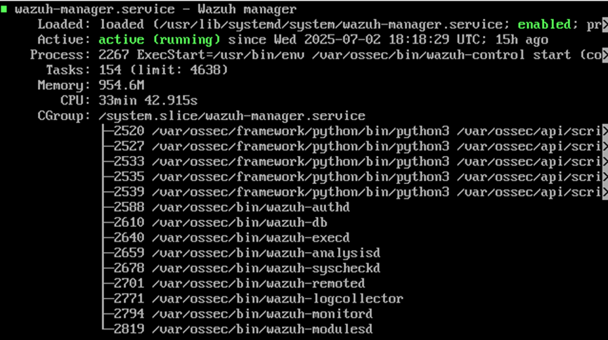

# Wazuh Installation

## Objective

Deploy the official Wazuh 4.12 OVA in Oracle VirtualBox and prepare the environment for security monitoring and agent deployment.

## Software Used

| Software | Purpose |
|----------|---------|
| Oracle VirtualBox | Hosted the Wazuh virtual machine. |
| Wazuh OVA 4.12 | Provided the pre-configured Wazuh environment. |
| Amazon Linux 2023 | Operating system running the Wazuh platform. |

## Deployment Approach

The initial plan was to deploy Wazuh using the all-in-one installation on an Ubuntu 22.04 LTS virtual machine. This attempt could not be completed because of disk space limitations on the host system.

To work within the available resources, the deployment was switched to the official Wazuh 4.12 OVA (Amazon Linux 2023), which provides a pre-configured environment with the Wazuh Manager, Indexer, and Dashboard.

## Implementation

The installation process followed the official Wazuh deployment approach using the Wazuh 4.12 OVA image.

The following tasks were completed:

- Installed Oracle VirtualBox on the Windows host machine.
- Downloaded the official Wazuh 4.12 OVA for Amazon Linux 2023.
- Imported the OVA into Oracle VirtualBox.
- Created the virtual machine and completed the initial configuration.
- Configured the virtual network to establish communication between the host system and the virtual machine.

## Verification

After completing the installation, the Wazuh Manager service was verified using `systemctl status` to confirm that the service was running correctly.

Command used to verify the service status:

```bash
sudo systemctl status wazuh-manager
```

The screenshot below shows the Wazuh Manager service in an active (running) state, confirming that the installation was successful and the service was operating correctly.

## Evidence

### Service Status Verification

The following screenshot shows the Wazuh Manager service running successfully after the installation.


## Lessons Learned

- Learned the deployment workflow using the official Wazuh 4.12 OVA.
- Understood the importance of verifying service status before accessing the Wazuh Dashboard.
- Gained practical experience configuring a virtual machine using Oracle VirtualBox.
- - Learned to plan VM storage before deployment, and that the official OVA is a practical alternative when disk space is limited.

