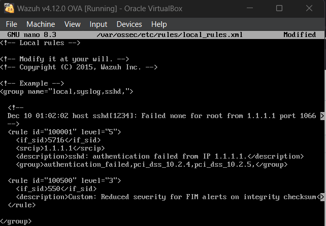

# Basic Rule Tuning

## Objective

Explore how Wazuh detection rules are customized locally through `local_rules.xml` in order to adjust alert severity and reduce alert noise.

## Software Used

| Software          | Purpose                                                  |
|-------------------|----------------------------------------------------------|
| Wazuh Manager     | Hosts and processes the local rules.                     |
| `local_rules.xml` | Used to define custom rules and adjust alert severity.   |
| Wazuh Dashboard   | Used to review alerts generated by the existing rules.   |

## Implementation

The local rules file on the Wazuh Manager (`/var/ossec/etc/rules/local_rules.xml`) was reviewed and customized. The following tasks were completed:

- Reviewed the structure of a Wazuh local rule (`id`, `level`, `if_sid`, `description`, `group`).
- Reviewed the example rule `100001` included in the file, which matches SSH authentication failures (parent rule `5716`) from the example IP address `1.1.1.1` at level 5.
- Added a custom rule, `100500`, that lowers the severity of File Integrity Monitoring alerts for checksum changes (parent rule `550`) to level 3.

### Custom Rule

```xml
<rule id="100500" level="3">
  <if_sid>550</if_sid>
  <description>Custom: Reduced severity for FIM alerts on integrity checksum changes</description>
</rule>
```

| Item               | Details                                                       |
|--------------------|---------------------------------------------------------------|
| Rule ID            | `100500`                                                      |
| Parent Rule        | `550` (Integrity checksum changed)                            |
| Original Severity  | `7` (as seen in the FIM alerts)                               |
| Custom Severity    | `3`                                                           |
| Configuration File | `local_rules.xml`                                             |

## Validation Status

The rule was written and reviewed in `local_rules.xml`, but its effect on generated alerts was **not validated** in the lab, so no alert with `rule.id: 100500` was captured.

Validation steps for a future run:

1. Check the configuration syntax: `sudo /var/ossec/bin/wazuh-analysisd -t`
2. Restart the manager: `sudo systemctl restart wazuh-manager`
3. Trigger a new FIM event on a monitored file.
4. Filter the Dashboard by `rule.id: 100500` and confirm the alert appears at level 3.
5. Compare it with the earlier rule `550` alerts at level 7.
6. Optionally test the log processing with `wazuh-logtest`.

## Evidence

### local_rules.xml

The local rules file showing the example rule `100001` and the custom rule `100500`.

[](https://github.com/Hayaoji/Wazuh-SIEM-Lab/blob/main/images/rule-tuning/custom-rule-adjustment.png)

## Lessons Learned

- Learned how local rules are structured and how a child rule can lower the severity of an existing rule using `if_sid`.
- Learned that rule changes require a Wazuh Manager restart to take effect.
- Learned that a configuration change should be validated with a captured alert (or `wazuh-logtest`) before it is considered complete.
